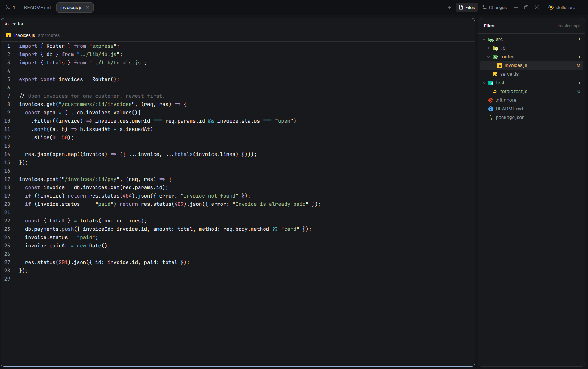

# kz-editor

Open files from the [Herdr](https://herdr.dev) side panel in their own tabs, next to your terminals and agents. Edit them and save with <kbd>Ctrl</kbd> <kbd>S</kbd>. When an agent changes a file that you have open, the tab follows the disk. When you have unsaved edits, kz-editor asks before it replaces anything.



## Features

- File tree for the folder of the focused terminal, with git marks: `M` modified, `U` new, ignored files dimmed
- Right-click menu: open, reveal in the file manager, open a terminal, new file or folder, cut, copy, paste, copy path, rename, delete to the Recycle Bin or Trash
- Search with <kbd>Ctrl</kbd> <kbd>E</kbd>: file names, paths and text in files, ranked like VS Code Quick Open
- One tab for each file. A click opens a preview tab, a double-click or an edit keeps it
- Editor with VS Code syntax colors (Dark+ or Light+), line numbers, folding, multiple cursors, and undo and redo
- Find in file, like the <kbd>Ctrl</kbd> <kbd>E</kbd> search: every match as a line to pick, match case and regular expressions, and a replace row. Go to line
- The indent of each file: tabs, or 2 or 4 spaces
- Untitled tab with <kbd>Ctrl</kbd> <kbd>N</kbd> for a quick note or a new file. <kbd>Ctrl</kbd> <kbd>S</kbd> asks where to save it
- Markdown preview in the GitHub style, with a switch to the source
- Images (PNG, JPEG, GIF, WebP, BMP, ICO, TIFF, SVG) and PDFs, with zoom and PDF text find
- Format button for JSON
- Safe next to agents: open files follow the disk, and kz-editor never writes over unsaved edits
- CRLF files stay CRLF

## Install

1. Clone the repo into the Herdr mods folder:

   ```sh
   git clone https://github.com/santikzz/kz-editor ~/.config/herdr-app/mods/kz-editor
   ```

2. Copy a layout. The Herdr layouts are read-only:

   ```sh
   herdr-app do layout.clone '{"name":"main","as":"my-main"}'
   ```

   In `~/.config/herdr-app/layouts/my-main.json`, change the Files block from `"mod": "files"` to `"mod": "kz-editor"`.

3. Add the keys to `~/.config/herdr-app/keys.json`:

   ```json
   "global": {
     "ctrl-e": "mod.open:kz-editor",
     "ctrl-n": { "command": "tab.new", "args": { "name": "Untitled", "mod": "kz-editor", "props": { "role": "file", "untitled": true } } }
   },
   "mod:kz-editor": {
     "ctrl-s": "kz-editor.save",
     "ctrl-f": "kz-editor.find",
     "ctrl-h": "kz-editor.replace",
     "ctrl-g": "kz-editor.goto",
     "ctrl-d": "kz-editor.next",
     "alt-z": "kz-editor.wrap"
   }
   ```

4. Check the mod:

   ```sh
   herdr-app check ~/.config/herdr-app/mods/kz-editor
   ```

With the Better Icons mod, the tree shows Material file icons.

## Keybinds

Herdr reads all keys from `keys.json`. To use other keys, bind them to `mod.open:kz-editor` (search), the `kz-editor.*` commands above and the `tab.new` action above (untitled tab). The `mod:kz-editor` keys work only while kz-editor has the keyboard, so the terminals keep them.

| Key | Action |
|---|---|
| <kbd>Ctrl</kbd> <kbd>E</kbd> | Open or close the search |
| <kbd>Up</kbd> <kbd>Down</kbd> | Select a search result |
| <kbd>Enter</kbd> | Open the selected result |
| <kbd>Esc</kbd> | Close the search |
| <kbd>Ctrl</kbd> <kbd>S</kbd> | Save. On macOS, <kbd>Cmd</kbd> <kbd>S</kbd>. In an untitled tab, Save as |
| <kbd>Ctrl</kbd> <kbd>N</kbd> | Open an untitled tab |
| <kbd>Ctrl</kbd> <kbd>F</kbd> | Find in the file. A one-line selection becomes the query. In a PDF, find text |
| <kbd>Up</kbd> <kbd>Down</kbd>, <kbd>Enter</kbd> | Pick a match, go to it |
| <kbd>Alt</kbd> <kbd>C</kbd>, <kbd>Alt</kbd> <kbd>R</kbd> | Match case, regular expressions |
| <kbd>Ctrl</kbd> <kbd>H</kbd> | Find and replace. The chevron in the find card also opens the replace row. <kbd>Enter</kbd> in the replace field replaces the picked match |
| <kbd>Ctrl</kbd> <kbd>G</kbd> | Go to a line, or `line:column` |
| <kbd>Ctrl</kbd> <kbd>D</kbd> | Select the word at the cursor, then the next match of the selection |
| <kbd>Alt</kbd> <kbd>Z</kbd> | Wrap long lines, or stop |
| <kbd>Esc</kbd> | Close the find card |
| <kbd>Ctrl</kbd> <kbd>Z</kbd> | Undo |
| <kbd>Ctrl</kbd> <kbd>Y</kbd> | Redo. On macOS, <kbd>Cmd</kbd> <kbd>Shift</kbd> <kbd>Z</kbd> |
| Click a file | Open it in the preview tab |
| Double-click a file | Open it and keep the tab |
| Right-click in the tree | Open the file menu |
| <kbd>Ctrl</kbd> + mouse wheel | Zoom an image or a PDF |
| <kbd>Page Up</kbd> <kbd>Page Down</kbd> | Go to the next or previous PDF page |

Shells use <kbd>Ctrl</kbd> <kbd>E</kbd> to go to the end of the line, and <kbd>Ctrl</kbd> <kbd>N</kbd> for the next command in the history. With these bindings, use <kbd>End</kbd> and <kbd>Down</kbd> in the terminal.

Undo and redo are the Herdr editor's own keys. Herdr binds <kbd>Ctrl</kbd> <kbd>Shift</kbd> <kbd>Z</kbd> to pane zoom, so it does not redo.

## Settings

Put your settings in `config.json` in the mod folder. Without this file, kz-editor uses these defaults:

```json
{
  "search": {
    "exclude": ["node_modules", "bower_components", ".git", ".svn", ".hg", ".DS_Store", "Thumbs.db"],
    "gitignore": true
  }
}
```

| Setting | What it does |
|---|---|
| `search.exclude` | Names and paths that the search skips. A name such as `dist` or `*.map` is skipped in every folder. A path such as `src/generated` starts at the root folder. Your list replaces the default list. |
| `search.gitignore` | `true` skips the files that `.gitignore` names. `false` searches them too. |

When you save the file, the mod loads again. If the file has an error, the search uses the defaults and shows the error at the bottom. Git does not track `config.json`, so an update keeps your settings.

## How it works

One mod has three roles:

- In the side panel, it draws the file tree.
- In a tab, it draws the editor. A shared registry links each tab to its file.
- With <kbd>Ctrl</kbd> <kbd>E</kbd>, it opens as a popup and draws the search. `git ls-files` lists the files and `git grep` finds the text, so `.gitignore` applies. A folder outside git uses an empty git repository, so the same commands work there.

Every 2 seconds, kz-editor reads each open file from disk:

| Your tab | The file on disk | What kz-editor does |
|---|---|---|
| No unsaved edits | Changes | Loads the new version |
| Unsaved edits | Changes | Asks: **Load disk version** or **Keep mine** |
| Unsaved edits | You close the tab | Saves your edits. If the disk version changed, writes them to `<file>.unsaved` |
| Untitled | You close the tab | Discards the text |

[RECIPE.md](RECIPE.md) describes the full build.

## Limits

- No IntelliSense or go to definition. Herdr does not give mods these parts of its editor.
- The editor has one selection. <kbd>Ctrl</kbd> <kbd>D</kbd> moves it to the next match. It does not add a cursor.
- The editor cannot mark all matches. The find card lists them instead, the first 200.
- An untitled tab keeps its text only while it is open. Closing it or restarting Herdr discards the text.
- Save as writes on this computer only: in the folder of the space's first terminal, or a folder under it. For a space on another machine, in your home folder.
- The search needs `git`. In a very large folder outside git, such as your home folder, listing stops after 10 seconds.
- Text search starts at 2 characters and shows 5 lines per file, 200 lines in total.
- Herdr has no TypeScript grammar. TypeScript uses the C# colors, because the JavaScript grammar stops at the first type. Vue and Svelte use the HTML colors, TOML uses YAML. Files without a grammar open without colors. A mod cannot add grammars.
- Files over 400 KB open read-only. Files over 1 MB do not open.
- Files on other machines save through `hc file write`, so `hc` must be on the PATH. A save checks that the file did not change, then writes it, so a change in that short gap is lost. On Windows, files on other machines open read-only. Images and PDFs on other machines do not open.
- The tree shows 500 entries per folder and 5,000 in total.
- The Markdown preview shows the first 32 KB of a file. Source shows all of it.
- A PDF shows its first 50 pages. On macOS and Linux, PDFs need poppler (`pdftoppm`, `pdfinfo`, `pdftotext`).
- The Markdown preview shows Mermaid diagrams and math as code.
- The tree menu acts on one item at a time and uses its own clipboard. On another machine, Delete removes the item permanently.
- Tested on Windows 10 with Herdr 0.1.18. macOS and Linux are not tested.

## License

[MIT](LICENSE). It includes [marked](https://marked.js.org) under the [MIT license](vendor/marked.LICENSE.md) and [Lucide](https://lucide.dev) icons under the [ISC license](icons/LICENSE-lucide.txt).
