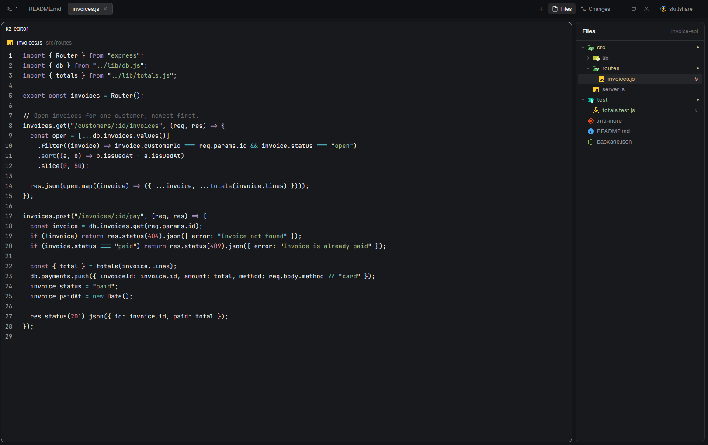

# kz-editor

A file tree in the side panel and an editor tab for each file, in the style of VS Code. Click a file to open it in a reusable preview tab, double-click to keep the tab, edit, and save with `ctrl+s`. Markdown files show a rendered preview with a switch to the source. JSON files have a Format button.

## What you see

- **Side panel tree** (a layout block, any width, best at 280 to 480 px): a 42 px header with "Files" and the root folder name. Rows are 24 px with 12 px indent per level, a chevron for folders, a Material Icon Theme icon, and the name. Git colors on names: added or untracked `ansi2` with a `U`, modified `ansi3` with an `M`, deleted or conflicted `ansi1`. Ignored files are `dim` at 55 % icon opacity. Folders show a 5 px dot in the color of the strongest change inside them. The row of the file in the shown tab uses the `selected` color.
- **File tab** (a tab whose only pane is this mod): a 34 px toolbar with the file icon, the name, the folder relative to the root (`dim`), and, on the right, the actions that apply: "Keep tab" (preview tabs), "Preview" and "Source" (Markdown), "Format" (JSON), and a solid "Save" button while there are unsaved edits. Under it, Herdr's built-in code editor with line numbers, folding and syntax colors from the theme's ANSI colors.
- **Tab name**: the file name, with "● " in front while there are unsaved edits.

## How it behaves

- The tree follows the focused terminal's folder. When a file tab has focus, the tree stays on that file's root. Each root remembers which folders were open.
- Single click on a file: if a tab already shows it, select that tab. Otherwise reuse this space's preview tab, or open a new preview tab. Double-click: the tab is kept, so the next click opens a new tab. Editing a preview tab also keeps it.
- Save with `ctrl+s` (`cmd-s` on macOS) or the Save button. A CRLF file is written back with CRLF.
- Every 2 s the open file is read from disk. With no unsaved edits, the editor follows the disk. With unsaved edits, a bar says "This file changed on disk." with "Load disk version" and "Keep mine".
- Closing a tab with unsaved edits saves them. If the file changed on disk meanwhile, the edits go to `<file>.unsaved` beside it, so nothing is lost.
- Markdown links: `http`, `https` and `mailto` open in the browser. Relative links open the file in kz-editor.
- Read only: files on another machine, and files over 400 KB. Over 1 MB, or binary: a message instead of the editor.
- Git colors refresh on a folder watch (local) and every 10 s.

## Built from

- `main.js`: one `View`, two roles by `props.role`: `tree` (default) and `file`.
- `tree.js`: folder listing (PowerShell `Get-ChildItem` on Windows, `sh` elsewhere, at most 500 entries per folder and 5,000 total), `git status --porcelain=v1 -z --untracked-files=all --ignored` for colors (`all` lists each file in a new folder, so those files are colored too), `watchFolder` for refresh.
- `tabs.js`: the registry in `shared("kz-editor.tabs")`, `{ [tabId]: { path, root, on, space, key, preview } }`. `openFile` runs `tab.new { space, name, mod: "kz-editor", props: { role: "file", file, key, space } }` and records the new tab id at once by comparing the space's tabs before and after. The `key` lets the tab's copy find its entry, also after a restart.
- `file.js`: `EditorState.new({ language, value, readonly, font_family, font_size, syntax })` and `Editor.new`, `TextView.markdown` for the preview, `readTextFile` and `writeTextFile(path, text, expected)` for conflict-safe saves, `tab.rename` for the "● " marker, `async close()` for the save on close.
- `icons.js`: reads `mods/better-icons/icons.json` (the Better Icons mod). Without it, the tree uses the Lucide icons in `icons/`.
- `keys.json`: `"mod:kz-editor": { "ctrl-s": "kz-editor.save" }`.
- Layout: a block `{ "mod": "kz-editor" }` where the file tree goes, for example the `files` child of the side panel stack.

## Watch out

- Herdr's editor has grammars for javascript, json, python, rust, go, yaml, bash, sql, ruby, java, c, cpp, lua, html, css and markdown. Other languages borrow the closest one: php and typescript use javascript, toml uses yaml, blade and vue use html. Pass an unknown name and the file shows without colors.
- A mod copy cannot learn its own tab id, and a new copy can start before `spaces()` shows its tab. Do not claim "the active tab": the old tab can still be active. Record the tab id in `openFile` and match by `key`.
- `run()` returns null; commands apply right after it returns, so `spaces()` already lists the new tab.
- Writing into the mod folder through a junction or symlink does not hot reload. Keep the real folder in `mods/`.
- `set_value` moves the cursor to the start when the disk version is loaded.
- The JS API of the editor has no cursor, selection or go-to-line control, no LSP and no find-in-files.

## Done when

- `herdr-app check mods/kz-editor` passes.
- A click on a file in the tree opens a tab named after it. A second click on another file reuses that tab. A double-click keeps the tab.
- Typing shows "● " on the tab name and a Save button. `ctrl+s` writes the file and removes both.
- A CRLF file stays CRLF after a save.
- A Markdown file opens in Preview, and Source shows the editor. A relative link opens the linked file.
- Format on a one-line JSON file indents it with 2 spaces.
- An outside change to an open, unedited file shows within 2 s. With unsaved edits, the "changed on disk" bar shows.
